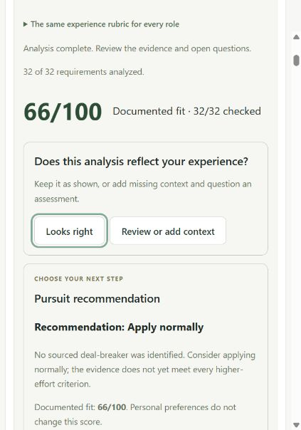
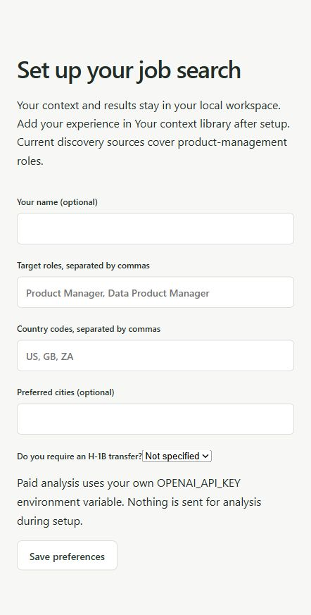
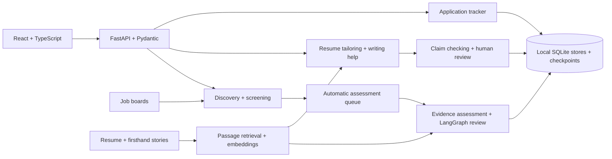

# Your Job Application OS

A local-first assistant that runs a product-management job search end to end: it finds new roles, scores how well your documented experience fits each one, tailors your resume with a source citation behind every claim, and tracks what you applied with.

[See the interface](#why-i-built-it) · [Architecture](#architecture) · [Run locally](#run-locally)

## Why I built it

Job searching with AI tools has two failure modes: hours of manual triage across job boards, and AI-written resumes that quietly invent experience. I built this for my own PM search to fix both. It does the tedious parts automatically, but it treats my real stories and resume as the only source of truth, and keeps me in control of every decision and every paid model call.

<p>
  
  
</p>

## How it works

1. **Discover.** Collects new PM postings from job boards, YC's Work at a Startup, HN "Who's hiring", Lenny's Jobs and Cosign, de-duplicates them, and ranks them against your skills profile.
2. **Assess.** Breaks each job description into requirements and checks each one against your own stories and resume, producing a documented-fit score and a Skip / Apply normally / Attack hard recommendation from editable, versioned rules.
3. **Tailor.** Drafts a role-specific resume (PAR, XYZ or STAR), cover letter or application answer. Every factual line must cite your source text; a separate model pass checks the claims, and you accept or decline each change.
4. **Track.** Saves the exact PDF you submitted with each application, with status, follow-ups and Excel export.

## Product principles

- **Evidence over generation.** No claim without a citation; missing evidence is flagged as a question, never filled in.
- **Human in the loop.** The app recommends, you decide. Nothing is submitted automatically.
- **No surprise costs.** Paid model calls run only on explicit request, are never retried silently, and are tracked per role.
- **Private by default.** All personal data stays in a local `.local/` workspace that git ignores.

## How it was built

I designed and built this solo, directing an AI coding agent (OpenAI Codex) through iterative development. I owned the product decisions: the workflows, the evidence and claim-checking rules, the cost and privacy guardrails, and the testing approach. The stack is React and TypeScript on the frontend, with FastAPI, Pydantic, LangGraph and SQLite running locally, plus OpenAI APIs and [Jev by TypeSafe](https://typesafe.ai/) for structured classification and assessment. The repository contains no candidate profile, resume, stories or databases.

## Architecture

React and TypeScript call a local FastAPI API with Pydantic models. Discovery and assessment run separately; LangGraph checkpoints persist evidence-review and pursuit workflows in SQLite. Retrieval selects passages from the candidate's documents for assessment and citation-backed writing.



Implementation details: [retrieval design](docs/rag-design.md), [Jev assessment](docs/jev-assessment.md), [discovery integrations](docs/discovery-integrations.md), and [API cost accounting](docs/api-costs.md). This is a locally run app; the screenshots above are the available product preview.

## Run locally

Requires Python 3.12 and Node.js with npm.

1. Create a Python environment: `python -m venv .venv`.
2. Activate it and run `pip install -r requirements.txt`.
3. In `frontend`, run `npm ci` and `npm run build`.
4. From the repository root, run `python -m uvicorn app.main:app --host 127.0.0.1 --port 8000`.
5. Open http://127.0.0.1:8000, choose your target roles and countries, then add your own documents or stories in **Your context library**.

Discovery is initially unscheduled; enable it in Discovery runs when ready. Paid automatic assessment is initially disabled. Board collection currently focuses on product-management roles, with partial coverage and source-dependent posting dates. It is not a universal job search engine.

For scan recovery, safe restarts, workspace migration and Windows scheduling, see the [operations guide](docs/operations.md).

## Personal data and model access

First startup creates an empty `.local/` directory containing SQLite databases and `.local/workspace/` containing your preferences, context controls, and personal copies of scoring criteria. Uploaded documents and stories also stay under `.local/`. Git excludes this directory. Back it up separately if needed; GitHub is a code backup, not a backup of your analysis history.

Set `JOB_REVIEW_DATA_DIR` to an absolute private directory to choose another location. Run one server process per data directory. Do not point the public product at an older personal workspace without an explicit migration.

Set `TYPESAFE_API_KEY` for Jev classification and assessment, and `OPENAI_API_KEY` for API embeddings, candidate skills extraction, and explicitly requested resume tailoring. Original source embeddings are reused until the source changes. Generative OpenAI calls are disabled for role assessment; resume drafting and claim checking use a separate generation-enabled adapter and the same local usage ledger. Never commit keys or personal data.

Your canonical resume is optional for evidence review. To register a separate master for future tailoring, place it under `.local/workspace/sources/master/` and set `source` in `.local/workspace/knowledge/canonical_resume_inventory.json` to its relative path. Uploading a resume to the context library supplies evidence, but does not silently make it an approved canonical master. Tailoring and application submission are not automated.

Generic defaults live in `criteria/`. Feedback changes the user's local copies, never the shared defaults. Work authorization starts unspecified. Current structured authorization checks specifically cover H-1B transfers; other authorization situations require manual review.

## Verify

Run `python -m pytest tests -q` and `npm run build` in `frontend`. Tests use fictional inputs, temporary directories, and no paid model calls.

### Connect YC / Work at a Startup

Install Microsoft Edge and the optional browser dependency:

```powershell
.venv/Scripts/python.exe -m pip install -r requirements-yc.txt
```

In **Discovery runs**, choose **Connect YC**. Sign in in the separate Edge window; the window closes when the authenticated Product / Fulltime directory is verified. Use **Check connection** to verify the saved session, then **Check YC now** to collect only YC. **Check now** still checks all enabled sources. Scheduled scans use the same private browser profile while the backend is running. A login in Codex or your regular browser is separate and is not copied.

The profile is saved under the active private data directory, `yc-browser/profile`, and is excluded from Git. Treat that directory as sensitive login data; do not share or upload it. Browser state is saved by Edge, not exported into an API response. The app never asks for your password. If YC expires the session, Discovery runs displays **Sign in again**. An access denial remains an access denial; the app does not bypass it or silently substitute the public YC collector.

The collector scrolls the directory and reads linked job descriptions. Coverage remains partial because company cards can omit roles; the scan reports loaded startups, warnings, and missing descriptions. No posting dates are inferred from sort order or first discovery. YC's sponsorship labels are retained as source claims, not proof of H-1B transfer eligibility. Existing YC IDs retain their history across the public-site to authenticated-directory transition.

### Additional public sources

Full discovery runs also check HN's official hiring-thread API, Lenny's Jobs, and Cosign. HN collection looks for explicit PM titles in top-level comments from the current monthly hiring thread, posted within the past 31 days (up to 800 comments). That is the hiring comment's date, not the employer's original vacancy date. Informal titles may be missed.

Lenny's uses a fresh anonymous Edge session with the optional Playwright dependency above. It reads only the first publicly available PM results page. Its gated date filter is not used, and update timestamps are not treated as posting dates. Cosign supplies only its public subset; fuller account-only results are not collected. These sources report partial coverage, including when no PM listings appear in their public preview. Missing JDs enter the existing description-retrieval flow.

Breakout List companies, Ramp vendor-report links, and Next Play's public RSS issues appear under **Discovery runs → Company and newsletter leads**. They refresh during full scans, stay in the local `source-leads.sqlite3` database, and never automatically become jobs or trigger model calls. Failed reads retain the last successful results with a visible error. Newsletter publication dates are not job-posting dates; paid/private issue content is not fetched. These connectors do not yet extract individual openings from newsletters or monitor each listed company's career site.

Worth checking roles in New opportunities can be selected with checkboxes and submitted together using **Analyze selected**. The local durable queue runs them one at a time after any active scan. Full JDs are required; changed listings must be selected again. Pending selections survive a restart; interrupted or failed paid attempts require an explicit retry. Costs appear by role under API costs (outside automatic scans).

### Reusable candidate skills profile

Your context library includes a separate skills profile. Saving an experience starts skills preparation, including on first use. You can also
prepare existing context explicitly. Later updates are incremental while the local server is running. It reads current firsthand
stories/raw evidence and the current master resume; coaching guidance is excluded.
A resume uploaded in this panel replaces the profile's resume input only, not the
master resume. LinkedIn links can import explicit public skills metadata when
available; login-only pages need pasted skills or an uploaded profile export.
Pasted LinkedIn skills and manual additions are listed claims and make no model call.

OpenAI extracts unrestricted skill names, equivalent names, work descriptions and
exact source quotes from bounded passages. A separate cached consolidation pass
merges equivalent labels. Extraction does not certify competence or approve resume
claims. Changed passages are processed incrementally; removed/replaced source
passages disappear from the active view. Corrections and hidden skills persist.

Requests use the existing Responses provider and shared usage ledger under
`candidate_skills`, with `store=false`. Assessment generation remains disabled.
Errors stop automatic preparation until the user resumes; completed passages are
reused. A server interruption requires explicit resume, avoiding silent repeated
billing. The profile can be inspected without triggering paid requests. Local
profile state, uploaded resume text and model outputs live in the private workspace,
not Git. Discovery now uses this profile for Jev matching against JD responsibilities.
Role preferences are checked separately; exact keywords and legacy weights do not
decide priority. High priority requires confident role and skills alignment with a
specific skills-fit judgment. Individual skills are classified independently for
explanation; their ranking or selection confidence cannot block High priority. Hidden skills are excluded; profile edits invalidate cached
initial verdicts. Refreshing the page never makes paid calls. Existing listings are
rechecked when included in a subsequent scan. Preferences remain in Your preferences,
separate from the skills and experience library.

### Evidence-based pursuit decisions

The initial screening policy is in `criteria/discovery-screening.json`. All active
skills participate, in request-size-bounded batches. Role fit and overall skills
fit decide priority; independent direct/transferable skill matches explain it.

`criteria/pursuit-policy.json` defines application-effort rules. Casual requires
at least 50/100 documented fit, a non-provisional score, no more than 50% of core
requirements with insufficient evidence, and established target-work alignment.
Otherwise the report says **Review evidence**, rather than automatically endorsing
an application or rejecting the candidate. Explicit constraint conflicts still
recommend Skip. Attack Hard retains its stricter dimension and core-evidence rules.
These are editable, uncalibrated product defaults, not hiring probabilities.
Existing workspace migrations add the baseline gates while preserving custom
Attack Hard thresholds. Reports requiring review appear under Analyzed jobs >
Unfinished / needs review and All analyzed; candidates retain their apply/pass choice.

## Resume tailoring

Open **Your jobs → Analyzed jobs → Tailor resume**, or use the button in a saved role's workspace. A current completed deep assessment and a base resume are required. The base can come from the master resume, the resume uploaded under Your context / Add skills, or pasted text for this role.

Choose PAR (default), XYZ, concise STAR, or your existing style. Optionally remember the choice for future jobs. **Prepare draft** explicitly sends the JD, base resume, selected original passages already retrieved during assessment, and candidate fact/conflict rules to OpenAI. It loads [the resume-tailoring skill](skills/resume-tailoring/SKILL.md) into both the drafting instructions and the separate claim-checking request. It does not send the entire story library, request new embeddings, or automatically tailor jobs during scans.

The server saves progress in the existing private SQLite cache. Reopening the page does not dispatch a new request. Identical successful inputs reuse the saved draft; failed or interrupted calls require explicit retry. A saved draft can resume at claim checking without repeating generation. API costs attribute drafting and claim checking to the role.

Each factual block needs exact source citations; numbers must occur in those citations. A separate model review checks support, ownership, scope, and conflicts. These checks are fallible and are not independent fact verification. Review wording and source excerpts, edit or remove flagged claims, then recheck edits. Approval is blocked until all current blocks pass checks and the candidate explicitly confirms review. Changing a draft removes its approval. Changed JD/source/policy inputs prevent approval or export of an outdated version.

Approved drafts can be downloaded as **plain text**. This first implementation does not produce Word/PDF layout exports or submit applications. It keeps the master resume unchanged. Model-call tests use an offline provider fixture; they validate orchestration and rejection paths, not production-model factual accuracy.

Resume drafts open in a local Tiptap document editor. Click and type in the resume, change paragraph styles, and use undo/redo. The evidence panel follows the selected paragraph and can be hidden. Save changes stores an unverified revision and revokes prior approval; Check changes runs the claim review before approval. New or unsupported wording can be saved while being corrected but cannot pass approval without a successful check. Closing with unsaved edits asks before discarding them. Downloads remain plain text.

Citation checks accept whitespace-only differences and recognize saved fact-rule claims by their exact source identifiers. Real wording mismatches remain flagged on the affected paragraph; valid paragraphs still receive the semantic claim check. Evidence metadata is retained through document edits and paragraph splits; edits never inherit verified status. The editor is loaded on demand and uses no external document-hosting service.

Tailoring now imports the master as an ordered item inventory. PDF imports use positioned text (including text stored out of reading order), retain serif/sans-serif font choice, heading and role styles, and split location/date fields. Generation returns replacements for existing item IDs; the server retains all other items and forbids changing contact and section headings. Framework selection changes wording, not section order or item count. Saved drafts from the older whole-resume generator offer an explicit rebuild action. The editable view reflows as wording changes; it is not a pixel-identical PDF export. Existing uploads without retained layout metadata use their available text; re-uploading retains the new template metadata.

### Resume content suggestions

Tailoring uses the target JD, saved assessment requirements and selected original evidence passages. Same-accomplishment rewrites retain the master layout and appear in yellow. Replacements, additions, removals, combinations and reordering are saved as pending suggestions with the original text, JD quotation, rationale and citations. Accept or decline each suggestion; accepting invalidates prior claim checks and approval. Run one claim check after reviewing the batch, then approve. No suggestion is silently accepted, and older drafts show an explicit option to prepare updated tailoring. Existing source conflicts still require correction. This workflow does not add new employer headers automatically or provide Word/PDF export.

Resume approval now requires at least 80% of professional-experience bullets (rounded up) to pass the chosen framework check, including unchanged master bullets. Exact component excerpts and full review coverage are validated locally; semantic judgments remain model-assisted. All numeric claims require a metric-meaning review, and unresolved evidence conflicts block approval independently of the 80% threshold. Existing drafts can run the stronger checks without regenerating wording. Qualitative results count for PAR/STAR/existing style; XYZ requires supported measurement.

### Application tracker

After applying externally, choose **Done — save & download PDF** in the resume editor. This saves current edits and downloads the exact saved version locally, with no model calls or evidence approval gate. AI draft checks are advisory for candidate edits. Open the saved job link, apply externally, then choose **I applied**, then confirm the date and that this is the resume you submitted. **Your jobs → Applied jobs** lists confirmed applications, with editable status, follow-up date and notes. **Export all to Excel** downloads all tracker rows (including rows hidden by the current filter).

Application history is stored locally in `applications.sqlite3` alongside the other private databases. Each entry preserves the submitted resume blocks and formatting, JD, and assessment evidence used for tailoring. Later tailoring edits do not replace that snapshot. The tracker retains the exact downloaded PDF; older text-only applications remain downloadable as text. PDFs use saved paragraph text, fonts, sizes, alignment, bullets and date columns. Pagination is generated for US Letter pages; it is not a byte-for-byte reproduction of an uploaded Word file. Repeat confirmations for the same saved job do not create duplicate entries. Scan cleanup does not remove application history. No model/API calls are used for tracking or export; no Google Sheets connection is required.

With Google Sheets connected and a destination selected, application additions and edits schedule one sync an hour after the first unsynced change. Later changes join that batch without delaying it. Successful manual sync cancels the pending batch; changes made during sync remain pending. The deadline survives server restarts and overdue work runs when the server starts. This uses a sleeping timer, not periodic checks or AI calls. A failed automatic sync keeps the changes and displays an error for manual retry.

### Job freshness and storage

New jobs opens on Active jobs: postings from the last four days, retained jobs, and jobs with uncertain posting dates. Older retained listings remain accessible with All saved. Keep job protects a discovery listing; selecting it for assessment or importing it into Saved roles also protects it. Imported assessments, tailoring drafts and application history are not deleted.

While the server is running, idle maintenance checks hourly and deletes unselected, unimported listings whose source-reported publication date is at least 14 days old. It removes listing descriptions, sightings, revision copies and per-listing keyword caches, retaining a compact identifier/source record and scan outcome history to prevent rediscovery. SQLite reuses freed pages; the file may not immediately shrink. Unknown, update-only and hiring-thread dates are not treated as vacancy publication dates. Date-only and relative dates use conservative bounds. Shared model/embedding caches and cost history are retained.

Watch company keeps a separate, editable company name, careers link, fit reason and desired roles. New openings returned by configured boards are marked as watched and can be filtered. Watching does not boost priority or add a new careers-site crawler. Different opening IDs at the same company remain eligible; previously removed IDs/URLs are suppressed even when reposted on a different board with the same canonical URL.
